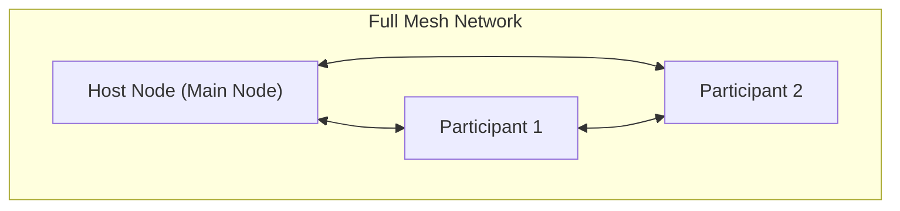
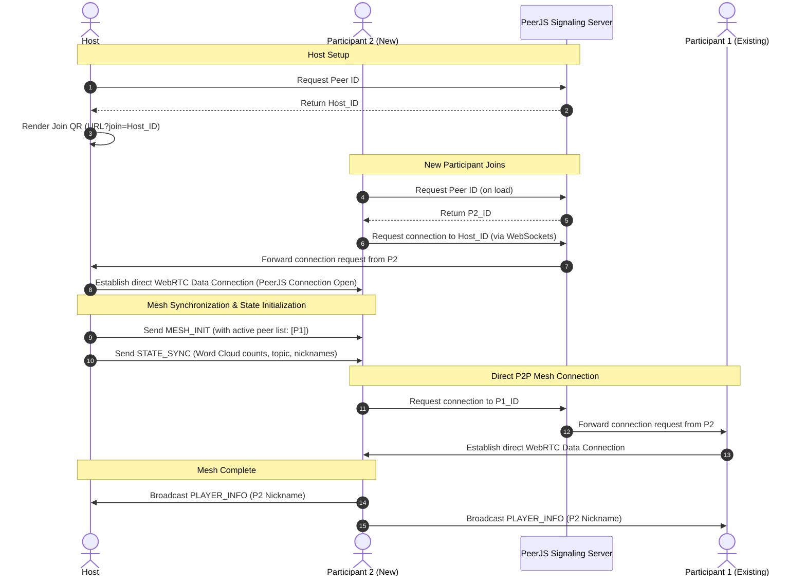

# P2P CloudWord — System Concept & Architecture

**Version:** 1.2 | **Last Updated:** 2026-06-14 | **Owner:** Team

## 1. Introduction
### Elevator Pitch
P2P CloudWord is a collaborative real-time word cloud generation system that operates without a central server. Using WebRTC Mesh networking (via PeerJS), participants can join a session via a simple QR code and contribute words that dynamically grow and move in a shared visual space.

### Target Audience
Groups, event organizers, and educators who need a quick, serverless way to collect and visualize real-time feedback or brainstorming results.

---

## 2. Technical Stack
| Layer | Technology | Notes |
|-------|-----------|-------|
| Engine/Library | D3.js v7 (Force Simulation Layout) | For dynamic word cloud visualization |
| Framework | Vanilla HTML/JS/CSS | Static web browser platform |
| Networking | PeerJS (WebRTC) | Mesh Topology for P2P connectivity |
| QR Integration | qrcode.js | Generates join links (e.g., `?join=HOST_ID`) |

---

## 3. Key System Features
- **Serverless Collaboration:** Real-time word cloud generation without a central server.
- **QR Code Entry:** Easy joining by scanning a QR code generated by the host.
- **Real-time Sync:** Words submitted by any participant are broadcasted as JSON messages.
- **Dynamic Visualization:** Word cloud updates frequency counts and re-renders dynamically.
- **Interactive Engagement (v1.2):** Ability to upvote existing words and send live reactions.
- **Host Moderation (v1.2):** Control panel for the host to filter or remove content.
- **Theme Customization (v1.2):** Ability to dynamically switch between Light, Dark (Neon), and Pastel theme variables.
- **PNG Export (v1.2):** Export high-quality 2x scaled PNG with topic header and watermark metadata.

---

## 4. Roadmap & Future Features
### Phase 1.2: Interactive & Professional (Completed)
- **Engagement Layer:** 
    - **Click-to-Upvote:** [x] Participants can click on words to increase their weight.
    - **Live Reactions:** [x] Floating emojis (🔥, ❤️) to show instant feedback.
- **Host Management:**
    - **Moderation Tools:** [x] Host can delete/hide words in real-time.
    - **Theme Customization:** [x] Switch between presets (Dark, Neon, Pastel).
- **Data Export:**
    - **PNG/SVG Export:** [x] Save the final result as a high-quality image.
    - **Session Stats:** [x] Basic analytics on word frequency and participant activity.

### Phase 1.3: Social & Persistent (In Progress)
- **Presence & Social:**
    - **User Presence Indicator:** [x] Visual list and initial-based hexagon avatars of active participants.
    - **Collaborative Distinction:** [ ] Color-coded words based on user contribution.
- **Persistence & History:**
    - **Cloud Archive:** [ ] Log of previous word clouds and word submission history.
    - **Local Storage:** [ ] Save session settings and cloud data to browser storage.
- **Advanced Networking:**
    - **Network Dashboard:** [ ] Visual feedback for NAT/ICE status and connection health.

---

## 5. System Architecture & Network Topology
The system runs entirely client-side using a **P2P Full Mesh Topology** coordinated by the Host.
- **Host (Initiator):** The session creator requests a Peer ID from the PeerJS Cloud Server. They act as the directory manager (Main Node), distributing the active participant list.
- **Participant (Client):** Connects to the Host first. The Host sends back other active Peer IDs via `MESH_INIT`. The Participant then automatically opens direct connections to all other peers, establishing a full mesh.
- **PeerJS Cloud Server:** Used solely as a **Signaling Server** to help peers find each other and establish direct WebRTC data channels. Once connected, no data flows through this server.

### Network Mesh Topology

---

## 6. Connection & Signaling Flow
This sequence diagram shows how a session is established and how a new participant joins the existing mesh.

### Detailed Workflow Phases
1. **Phase 1: Session Initialization (Host):**
   - The host initializes `CloudNetwork`, which connects to the PeerJS signaling server to retrieve a unique peer ID.
   - A QR code and URL (containing the host ID) are generated for sharing.
2. **Phase 2: Joining the Session (New Client):**
   - The participant opens the join URL, initializing their own PeerJS connection.
   - The participant initiates a WebRTC connection to the Host's Peer ID.
3. **Phase 3: Mesh Construction (Host Mediation):**
   - Upon successful connection, the Host dispatches:
     - `MESH_INIT`: list of other connected peers (e.g. `[P1_ID]`).
     - `STATE_SYNC`: the current active words, topic, and participant nicknames map.
   - The new participant connects directly to the other peers (`P1_ID`) listed in `MESH_INIT`.
4. **Phase 4: Collaboration (Event Syncing):**
   - Once all peers are connected in a full mesh, all actions (word submissions, upvotes, reactions, quiz responses) are broadcasted directly to all connected peers in real-time.

---

## Related Documents
- Mechanics: [Interactive Mechanics](./05-interactive-mechanics.md)
- Backlog: [Product Backlog](../agile/01-product-backlog.md)
- System Design: [System Design](./01-system-design.md)
