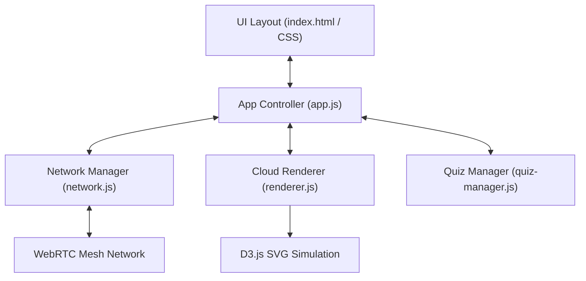
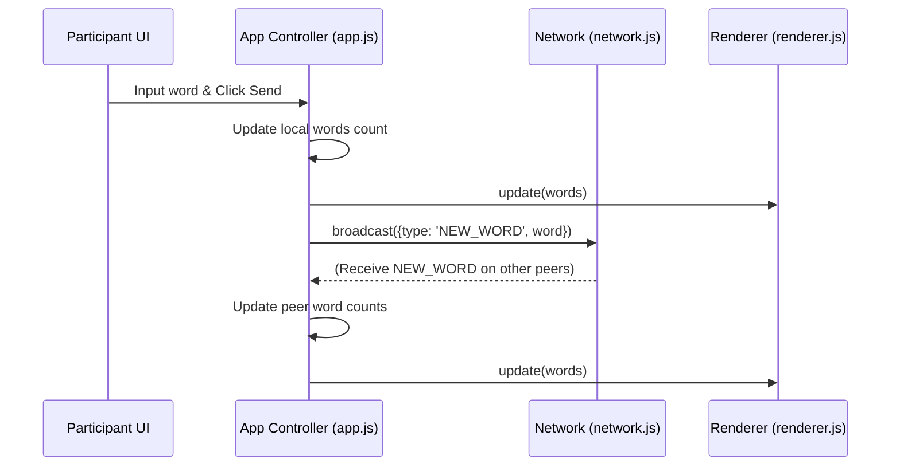
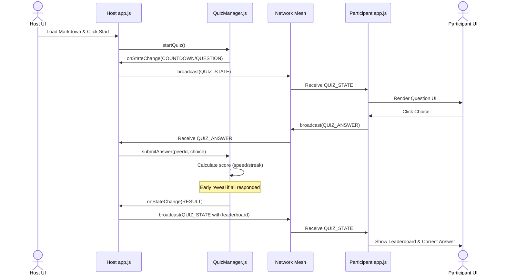
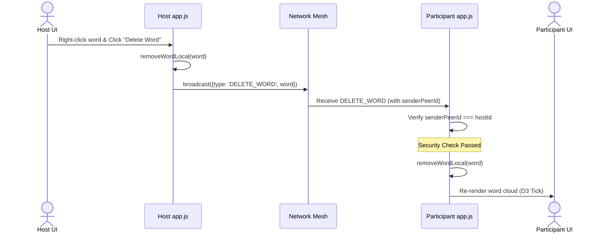
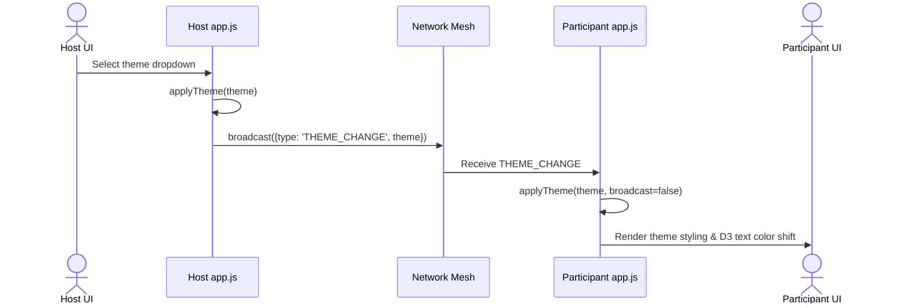

# P2P CloudWord — System Design

**Version:** 1.2 | **Last Updated:** 2026-06-14

## Subsystem Breakdown

The system consists of 5 main components cooperating via the Mediator and Facade design patterns:

> [!NOTE]
> Detailed class interfaces, fields, methods, and class relationships are documented in [02-class-diagram.md](./02-class-diagram.md).

### 1. Network Manager (`network.js`)
Responsible for all PeerJS WebRTC interactions. Implemented as the `CloudNetwork` class (Singleton, Facade, Observer). Manages peer connections, handles network event listeners, and broadcasts messages across the mesh network.

### 2. Word Manager (in `app.js`)
Handles the local state model for the word cloud. Tracks active words and frequency counts in a local Map and updates session states.

### 3. Quiz Manager (`quiz-manager.js`)
Authoritative engine managing the quiz state machine on the Host's side. Parses question data, handles timer intervals, and computes speed/streak scoring results.

### 4. Cloud Renderer (`renderer.js`)
Manages the D3 force simulation layout and SVG text rendering loop. Employs entry-update-exit selectors and captures canvas mouse events (clicks and right-click context menus).

### 5. App Controller (`app.js`)
Acts as the central Mediator. Hooks interface triggers, responds to network payloads, routes state syncing processes, and toggles system view modes.

---

## Data Flow

### Word Cloud Mode

### Quiz Mode

### Delete Moderation Flow (Host-Only)

### Theme Switcher Sync Flow (Host-Only)

---

## Known Gaps (toward Kahoot-style quiz, no database)
- ~~Scoring is flat (100 pts per correct answer); no speed-based bonus.~~ Resolved in [US-QZ-03](../agile/user-stories/US-QZ-03.md): scoring now scales with remaining time and rewards answer streaks.
- ~~`getQuestionStats()` assumes a fixed 4-option array instead of `question.options.length`.~~ Resolved in [US-QZ-03](../agile/user-stories/US-QZ-03.md).
- ~~Result reveal only happens on timer expiry — no early reveal when all connected participants have answered.~~ Resolved in [US-QZ-03](../agile/user-stories/US-QZ-03.md): `QuizManager.setActivePeerCount()` enables early reveal.
- ~~No player nickname; leaderboard currently keys on raw Peer IDs.~~ Resolved in [US-QZ-04](../agile/user-stories/archives/US-QZ-04.md): peers exchange nicknames via `PLAYER_INFO`/`STATE_SYNC.nicknames`, and the peer list / leaderboard render display names.

All planned items for this iteration are resolved.

---

## Proposed Feature: Interactive Participant Characters (Claude Nodes)

### Overview
To increase visual engagement during collaborative word cloud sessions, we propose adding a character-based presence system at the bottom of the Word Cloud view. Each connected participant will be represented by a randomly generated orange "Claude" character walking around.

### Mechanics & Animations
1. **Locomotion:** Characters stroll around randomly in a dedicated "ground level" zone below the D3 word cloud SVG container.
2. **Dynamic Speech & Expression:** When a participant submits a word or reaction, their corresponding character triggers an expression (e.g. jumps, displays a temporary speech bubble with their submitted word, or plays a floating reaction animation).
3. **Random Generation (Procedural Styling):** Characters are dynamically built using SVG assets with random features (e.g. faces, hats, items) colored in Claude-themed orange shades (`#ea580c` / `#f97316`).

### System Architecture Impact
- **Renderer (`renderer.js`):** Add a `CharacterRenderer` module managing these visual assets at the bottom of the canvas, utilizing D3 transitions or standard `requestAnimationFrame` for locomotion.
- **App Controller (`app.js`):** Intercepts `PLAYER_INFO` and `NEW_WORD`/`REACTION` events to spawn/update characters and trigger their respective action states.

---

## Related Documents
- Mechanics: [Interactive Mechanics](./05-interactive-mechanics.md)
- Data Schema: [Data Schema](./03-data-schema.md)
