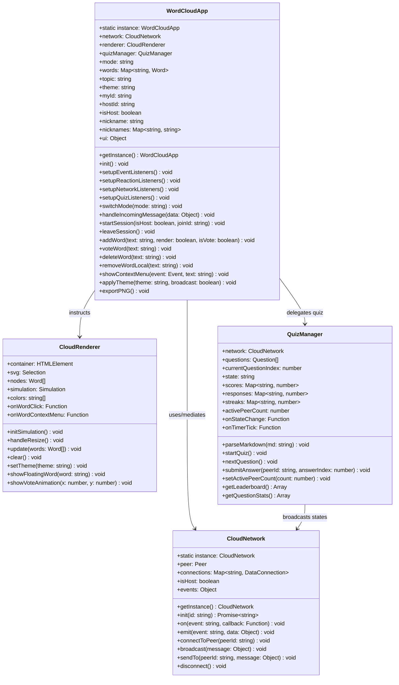

# P2P CloudWord — Class Diagram

**Version:** 1.0 | **Last Updated:** 2026-06-14 | **Owner:** Team

This document details the object-oriented design and class APIs for the P2P CloudWord application.

---

## 1. Class Relationships (Mermaid)

---

## 2. Subsystem API Definitions

### 2.1 `WordCloudApp` (Main Controller)
Implements Singleton, Mediator, and Strategy patterns. It is responsible for orchestrating the overall application lifecycle and mediating events between the network, quiz manager, and renderer.

* **Key Properties:**
  * `mode`: Defines active application mode (`'cloud'` | `'quiz'`).
  * `words`: `Map<string, Word>` storing active word frequencies.
  * `topic`: Current topic set by the host.
  * `theme`: Active visual theme (`'light'` | `'dark'` | `'pastel'`).
  * `hostId`: Stores the Peer ID of the session host.
  * `isHost`: Boolean indicating if the local instance is the host.
  * `nickname`: Host or participant display name.
  * `nicknames`: `Map<string, string>` mapping Peer IDs to nicknames.
* **Core Methods:**
  * `startSession(isHost, joinId)`: Initializes PeerJS and configures the role.
  * `addWord(text, render, isVote)`: Increments word count and notifies renderer.
  * `deleteWord(text)`: Purges word locally and broadcasts `DELETE_WORD` to the mesh.
  * `applyTheme(theme, broadcast)`: Switches the visual theme locally and syncs to peers if host.
  * `exportPNG()`: Encapsulates the SVG to Canvas serialization and PNG download.

### 2.2 `CloudNetwork` (P2P Mesh connection)
Implements Singleton, Facade, and Observer patterns. Wraps PeerJS API to manage P2P WebRTC data channels.

* **Key Properties:**
  * `connections`: `Map<string, DataConnection>` mapping Peer IDs to WebRTC channels.
  * `events`: Event dispatch table matching the Observer pattern.
* **Core Methods:**
  * `init(id)`: Asynchronously sets up the Peer instance.
  * `connectToPeer(peerId)`: Instantiates a PeerJS data connection and registers events.
  * `broadcast(message)`: Sends JSON data to all connected channels.

### 2.3 `CloudRenderer` (Visualization Engine)
Implements Facade pattern for D3.js. Manages SVG element mapping and the force simulation layout.

* **Key Properties:**
  * `simulation`: D3 force simulation node layout engine.
  * `colors`: Array of hex/CSS color tokens representing active word cloud text colors.
  * `onWordContextMenu`: Callback triggered on right-clicking word elements.
* **Core Methods:**
  * `update(words)`: Executes the D3 Enter-Update-Exit selection transition.
  * `handleResize()`: Dynamic redraw listener updating center force configurations.
  * `setTheme(theme)`: Updates color array and triggers fill transition animation.

### 2.4 `QuizManager` (Authoritative Quiz Engine)
Maintains the authoritarian state machine for the host in Quiz Mode.

* **Key Properties:**
  * `state`: Active phase (`LOBBY` | `COUNTDOWN` | `QUESTION` | `RESULT` | `FINAL`).
  * `scores`/`streaks`: Maps storing active game statistics.
* **Core Methods:**
  * `parseMarkdown(md)`: Tokenizes markdown files into quiz objects.
  * `submitAnswer(peerId, answerIndex)`: Calculates score using speed and streak formulas.
