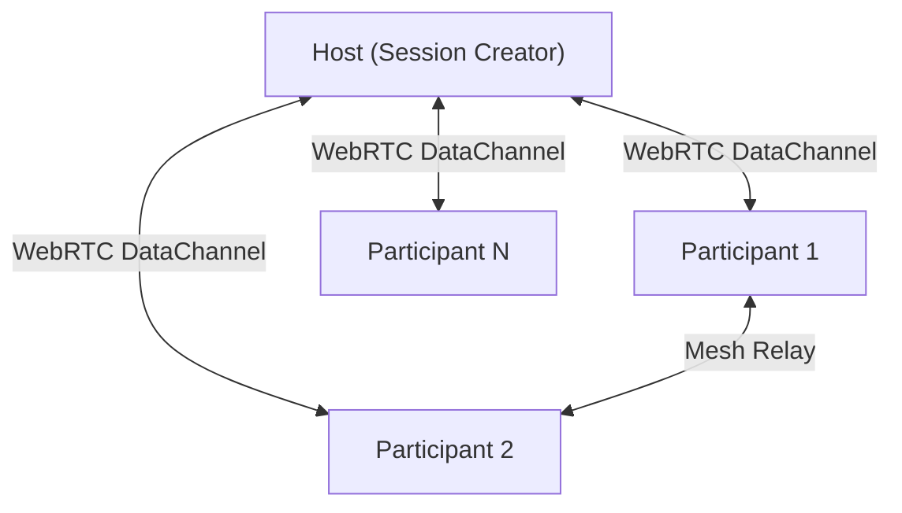

# ☁️ CloudWord (WebRTC P2P Word Cloud & Quiz) — Game Design Document & Technical Specification

**Code Name:** `webrtc-wordcloud` (G061)  
**Game ID:** `webrtc-wordcloud`  
**Engine / Tech:** HTML5 / Vanilla JavaScript / D3.js v7 (Force Simulation) / PeerJS (WebRTC DataChannel P2P Mesh) / QRCode.js  
**Category:** การศึกษา / มัลติเพลเยอร์ / เครื่องมืออินเทอร์แอคทีฟ  
**Deployment / URL:** `/games/webrtc-wordcloud/index.html`  

---

## 1. Overview & Core Vision

### 1.1 Elevator Pitch
**CloudWord (WebRTC P2P Word Cloud & Quiz)** เป็นแอปพลิเคชันและมินิเกมสำหรับการมีส่วนร่วมของผู้คนแบบเรียลไทม์ (Audience Engagement & Collaborative Activity) ทำงานบนบราวเซอร์แบบ **Peer-to-Peer (P2P Mesh Network)** 100% ผ่าน **WebRTC** และ **PeerJS** โดยไม่ต้องพึ่งพา Backend Database หรือเซิร์ฟเวอร์กลาง

### 1.2 Key Features
1. **Interactive Word Cloud**: ผู้เข้าร่วมสามารถส่งข้อความ/คำศัพท์เข้ามา และโหวตคำที่ชอบ เพื่อให้ D3.js แสดงผลคำที่มีขนาดและแรงดึงดูดแบบไดนามิก
2. **Interactive Quick Quiz Mode**: โฮสต์สามารถโหลดไฟล์คำถาม (.md) หรือสร้างคำถามผ่าน **Quiz Editor Tool** (`quiz-editor.html`) เพื่อเปิดโหมดตอบคำถามแข่งขันแบบจับเวลา พร้อมสรุปคะแนนสด
3. **P2P Mesh Network Architecture**: รองรับการกระจายสถานะ (State Synchronization) ระหว่าง Host และ Participants แบบ Serverless
4. **Instant Join via QR Code / URL**: ผู้เข้าร่วมสแกน QR Code หรือกดลิงก์แชร์เพื่อเข้าร่วมเซสชันได้ทันทีโดยไม่ต้องติดตั้งหรือสมัครสมาชิก
5. **Live Moderation & Reactions**: มีระบบส่ง Emoji Reaction ลอยบนหน้าจอ และ Host สามารถคลิกขวาเพื่อลบคำที่ไม่เหมาะสมออกจาก Word Cloud ได้

---

## 2. System Architecture & Components



### 2.1 File Structure
```
public/games/webrtc-wordcloud/
├── index.html              # Main Application & Game Canvas
├── quiz-editor.html        # Quiz Authoring & Markdown Export Tool
├── sample-quiz.md          # Sample Quiz File
└── src/
    ├── css/
    │   ├── style.css       # Theme, Glassmorphism, Responsive UI
    │   └── quiz-editor.css # Editor Styling
    └── js/
        ├── app.js          # Main Application Controller & UI Binder
        ├── network.js      # PeerJS P2P Mesh Network Manager
        ├── quiz-manager.js # Quiz State Machine & Timer Logic
        ├── quiz-editor.js  # Quiz Authoring & Validation Logic
        └── renderer.js     # D3.js Word Cloud & Physics Engine
```

---

## 3. Communication Protocol (P2P Data Channel)

### 3.1 Packet Types
- `NEW_WORD`: ส่งคำใหม่เข้า Word Cloud
- `VOTE_WORD`: โหวตคำศัพท์เพิ่มคะแนน/ขนาด
- `DELETE_WORD`: Host ลบคำที่ไม่เหมาะสม
- `STATE_SYNC`: ส่งสถานะทั้งหมดให้ผู้เข้าร่วมใหม่ (Peers, Words, Quiz State)
- `REACTION`: ส่ง Emoji Reaction ลอยข้ามจอ
- `QUIZ_ACTIVATE`: เปิดโหมดควิซ
- `QUIZ_QUESTION`: ส่งคำถามและตัวเลือกไปยังผู้เล่น
- `QUIZ_ANSWER`: ผู้เล่นส่งคำตอบมายัง Host
- `QUIZ_TIMER`: นับถอยหลังเวลา
- `QUIZ_RESULT`: แสดงผลคะแนนและอันดับ

---

## 4. Integration with GameDevJS Hub

- **Launcher URL**: `/games/webrtc-wordcloud/index.html`
- **Modal Mode**: Standalone Fullscreen / Responsive Iframe
- **Category in Hub**: มัลติเพลเยอร์ / การศึกษา (WebRTC P2P)
