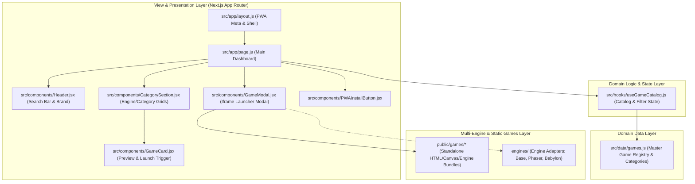

# Software System Design — GameDevJS Hub

---

## 1. System Architecture Overview

`web_gamedevjs-hub` (GameDevJS Hub) ถูกพัฒนาขึ้นบนสถาปัตยกรรม **Next.js (App Router)** พร้อมความสามารถ **Progressive Web App (PWA)** รองรับการรันแบบ Standalone Offline และมีระบบ **Multi-Engine Game Launcher** ที่รองรับทั้ง HTML5 Canvas, Phaser 3, Babylon.js และ Three.js/WebGPU

โครงสร้างของระบบถูกปรับปรุงตามหลักการของ **Poteto Mode (PStack Architecture Principles)**:
- **Model the Domain**: แยกชุดข้อมูล Master Game Catalog และประเภทหมวดหมู่ไว้ที่ [`src/data/games.js`](../../src/data/games.js)
- **Boundary Discipline**: ควบคุม State การค้นหา การกรอง และการเปิดเล่นเกมผ่าน Custom Hook [`src/hooks/useGameCatalog.js`](../../src/hooks/useGameCatalog.js)
- **Minimize Reader Load**: สกัด Section แสดงผลการ์ดเกมแต่ละหมวดหมู่ออกเป็น Reusable Component [`src/components/CategorySection.jsx`](../../src/components/CategorySection.jsx) ส่งผลให้หน้าหลัก [`src/app/page.js`](../../src/app/page.js) กระชับและชัดเจน

---

## 2. Core Subsystems & Architecture

---

## 3. Subsystem Breakdown

### 3.1 Domain Data Model (`src/data/games.js`)
- รวบรวมรายชื่อเกม สังกัดหมวดหมู่ URL รูปภาพหน้าปก และสี Gradient ประจำเกม
- รองรับการจัดกลุ่มตามประเภทเทคโนโลยี:
  - `ปริศนา / ฝึกสมอง / ฟิสิกส์` (HTML5 Canvas & Vanilla JS)
  - `กระดาน / วางกลยุทธ์`
  - `Phaser 2D Engine` (Phaser 3)
  - `Babylon.js 3D Engine` (Babylon.js WebGL)
  - `Three.js & WebGPU 3D Engine` (Three.js, WebGL 2, WGSL Shaders)

### 3.2 Catalog State Controller (`src/hooks/useGameCatalog.js`)
- จัดการ Reactive State: `searchKeyword`, `selectedCategory`, และ `activeGame`
- ประมวลผล Filtering แบบ Real-time ผ่าน `useMemo` เพื่อประสิทธิภาพในการ Render

### 3.3 Modular Section Component (`src/components/CategorySection.jsx`)
- Component สำหรับ Render ส่วนแสดงผลเกมของแต่ละหมวดหมู่ มีการคำนวณจำนวนเกมและ Badge สีเฉพาะของแต่ละ Engine อัตโนมัติ

### 3.4 Game Modal Launcher (`src/components/GameModal.jsx`)
- Sandbox Container ทำหน้าที่รันเกมผ่าน HTML5 Iframe Isolation
- ควบคุมการเปิด/ปิด Fullscreen, รองรับคีย์ลัด (ESC เพื่อปิด), และป้องกัน Event Leaks ออกมายังหน้าหลัก

### 3.5 Progressive Web App (PWA) Layer
- `public/sw.js`: Service Worker สำหรับ Offline Caching
- `public/manifest.json`: กำหนด App Name, Icons, Display Mode (Standalone)
- `src/components/PWAInstallButton.jsx`: จัดการ Event `beforeinstallprompt`

---

## Related Documents
- Concept: [Game Concept & Architecture](../gdd/00-concept.md)
- Class Diagrams: [Class Diagram & Data Flow](./02-class-diagram.md)
- Data Schema: [Data Schema & Persistence](./03-data-schema.md)
- Product Backlog: [Product Backlog](../agile/01-product-backlog.md)
- Master Index: [Documentation Master Index](../index.md)
