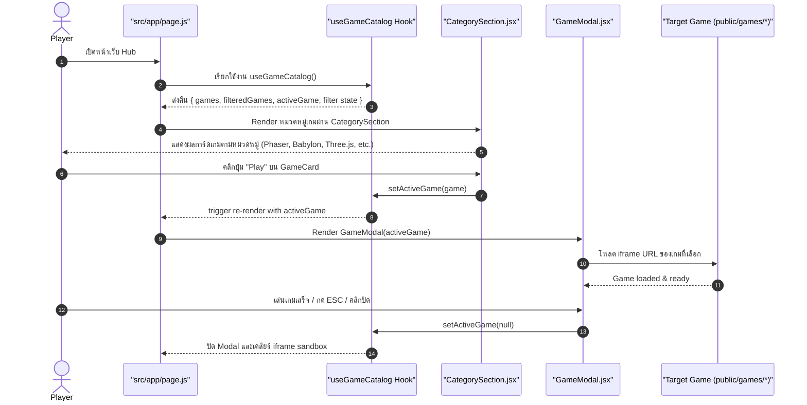
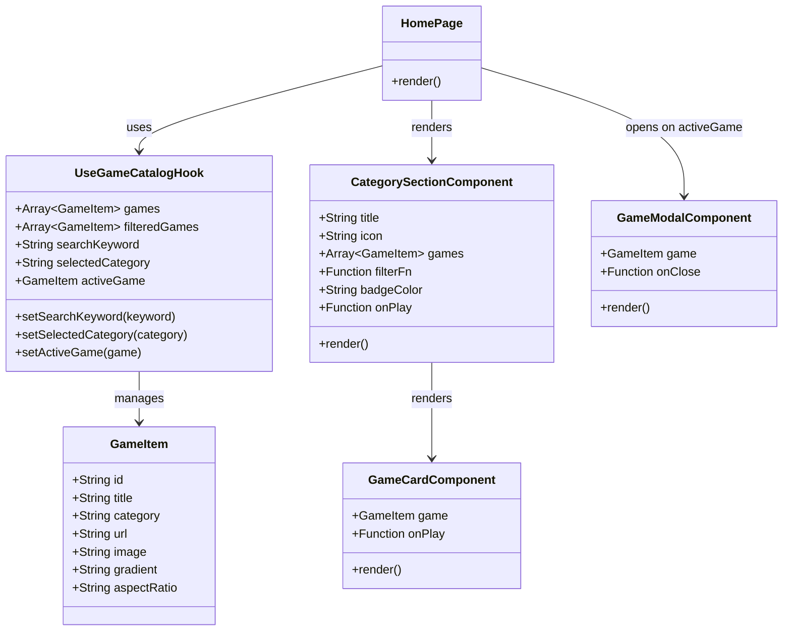

# Software Class Diagram & Flow — GameDevJS Hub

---

## 1. Hub Interaction Sequence Diagram

---

## 2. Component & Architecture Class Diagram

---

## Related Documents
- System Design: [Software System Design](./01-system-design.md)
- Data Schema: [Data Schema & Persistence](./03-data-schema.md)
- Master Index: [Documentation Master Index](../index.md)
